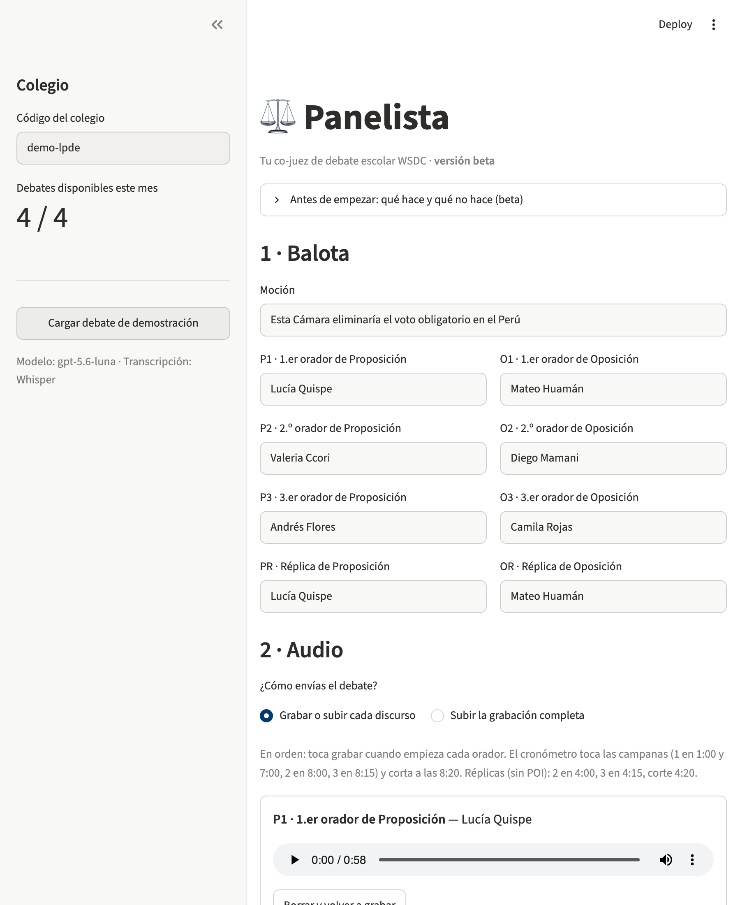
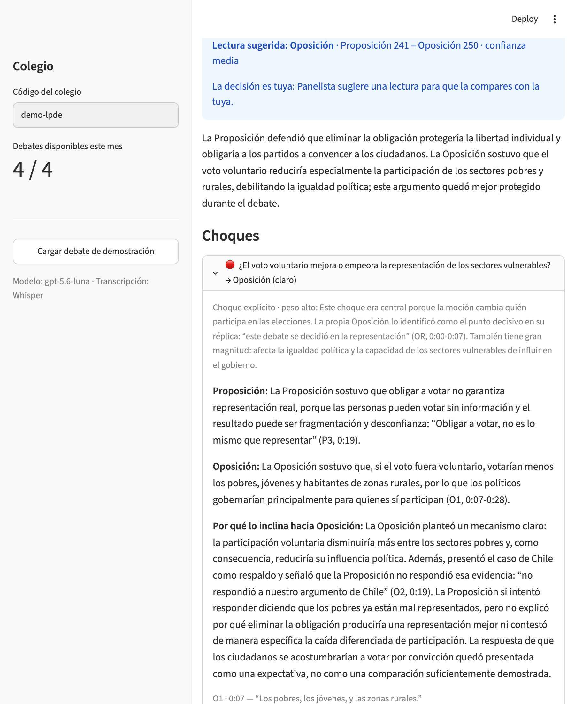
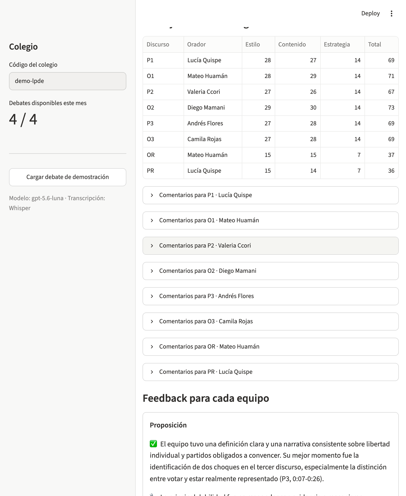
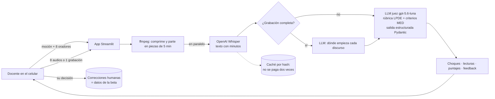

# ⚖️ Panelista

**Ayudamos a docentes de colegios en regiones del Perú a juzgar debates escolares: suben la grabación desde el celular y reciben los choques del debate, lecturas posibles y puntajes de orador de referencia.**

> Versión **beta** para la Liga Peruana de Debate Escolar (LPDE), formato WSDC. Panelista no decide quién gana: ayuda a que el docente aprenda a decidirlo.

- **Demo:** _URL pública: pendiente (Streamlit Community Cloud)_ · o en local, ver [Cómo correrlo](#cómo-correrlo)
- **Video de respaldo:** _pendiente_

---

## 1. One-liner

Hacemos **retroalimentación de jueceo de debate** para **docentes de colegios en regiones del Perú** mediante **transcripción con Whisper y un juez de IA con salidas estructuradas** que identifica los choques y sugiere puntajes según la tabla de la LPDE.

## 2. Founder

En el colegio, inicié el club de debate y ganamos un torneo nacional en 2 años. Parte fundamental de ese proceso fue tener gente con experiencia que sirvieron de jueces, con su feedback y recomendaciones. Ahora que participo como juez para torneos que buscan descentralizar el debate en escuelas de todo el Perú, entiendo la importancia de formar buenos jueces para que esta práctica sea académicamente sólida. Sin embargo, soy consciente de las limitaciones que tienen los docentes de colegios, especialmente en regiones del país, para acceder a entrenamiento y recursos enfocados en formarse como jueces. Para descentralizar el debate, se necesitan herramientas accesibles, de bajo costo, y utilizables en horarios variables que le permitan a los docentes formarse como jueces y ofrecer estándares académicos alineados con las tendencias en torneos nacionales e internacionales.

## 3. Problema

**Quién lo sufre.** Los docentes que llevan sociedades de debate en colegios fuera de Lima. La LPDE busca descentralizar el debate escolar, pero la mayoría de torneos y de jueces con experiencia están en Lima.

**Cuánto le cuesta.**
- En Lima, los jueces de los torneos escolares son universitarios que debatieron. En muchas regiones esa comunidad no existe, y **los mismos docentes terminan juzgando** sin haberse formado.
- Sin un buen juez, los estudiantes no reciben el feedback que necesitan para mejorar. Un debatiente nos dijo: *"Sin el feedback de los jueces, es difícil entender dónde se debe mejorar."*
- Formarse cuesta tiempo y dinero (viajar, capacitaciones, participar en torneos), y muchos docentes tienen pocas herramientas y poca experiencia digital.

**Cómo lo resuelven hoy.** Aprenden juzgando en torneos, con manuales (como el de iniciación WSDC de la LPDE) o, si tienen suerte, con jueces con experiencia de su ciudad. Los colegios practican unas dos veces por semana, y casi siempre sin un juez formado.

**Conversaciones con usuarios** (notas en [`docs/research/`](docs/research/)):

| # | Quién | Lo más importante |
|---|---|---|
| 1 | Director académico, LPDE | Los docentes en regiones juzgan torneos pero no tienen cómo formarse; la herramienta debe ser intuitiva y accesible. |
| 2 | Juez, LPDE | *"La decisión de quién gana… debe permanecer en los humanos."* Lo clave es identificar los choques y distinguir lo importante de lo que *"suena bien pero está poco probado"*. |
| 3 | Debatiente (menor, anónimo) | Los buenos jueces ordenan los choques y se enfocan en cómo mejorar, *"no deben contarnos el debate otra vez"*. |

Lo que cambió en el producto: Panelista ya no dice "Gana X". Muestra una **lectura sugerida** para que el docente la compare con la suya, y pone el foco en **los choques y el feedback**.

## 4. Solución e insight

**La solución.** El docente escribe la moción y los 8 oradores en orden, graba cada discurso desde el celular (o sube la grabación completa) y en unos 2 minutos recibe:
- los **choques** del debate, con su tipo, peso, margen y **cómo se decide** cada uno, con citas textuales y su minuto;
- una **lectura sugerida** y la mejor **lectura alternativa**;
- **puntajes de orador de referencia** (tabla LPDE: 60–80, réplicas 30–40) con fortalezas, qué mejorar y **cómo**;
- un formulario para que el docente o un juez anote **su propia decisión**. Esas correcciones son los datos con los que la beta mide y mejora su precisión.

**El insight.** Lo que un docente nuevo necesita no es un veredicto: es un **juez con experiencia al lado** que le muestre dónde chocaron los equipos y por qué importa cada choque. Ese conocimiento existe y está escrito (manuales de la LPDE, talleres de jueceo del MED), pero no llega a quien lo necesita en el momento en que juzga. Panelista lo aplica a *su* debate.

**Primeros resultados** (más en [`docs/evaluacion/`](docs/evaluacion/)):
- En la gran final del MED 2026, comparada con el *flow* del director académico de la LPDE (lectura preliminar de sus notas, pendiente de su confirmación), Panelista encontró **4 de sus ~6 choques**, sin inventar ninguno, y los resolvió igual en 2 de 4. Las diferencias fueron argumentos que *sonaban bien pero no estaban probados*: lo mismo que nos advirtió el juez de la conversación 2.
- Sus puntajes se parecen a los de jueces reales: en el tab público del MED 2025 (671 puntajes) la media es 68,9 (DE 2,4); la de Panelista en la final, 68,3 (DE 3,3).

## 5. Why now

- **Transcripción barata y buena en español** (Whisper): una hora de debate cuesta unos US$0,36 y se transcribe en menos de un minuto partiéndola en piezas en paralelo.
- **LLMs que razonan sobre textos largos y devuelven estructuras confiables.** Hace tres años un modelo no podía leer un debate de una hora completo, ni devolver un formulario con 8 puntajes que respeten la tabla. Hoy un modelo pequeño (gpt-5.6-luna) lo hace por unos US$0,02.
- **Todos los docentes tienen un celular** que graba audio, y Streamlit permite publicar una app web gratis.
- **La LPDE está empujando la descentralización ahora**, y necesita formar jueces en regiones.

## 6. Demo

**URL:** _pendiente_ · Para probar sin grabar nada: botón **"Cargar debate de demostración"** en la barra lateral y luego **"Juzgar el debate"**.

El debate de demostración es **sintético**: un guion escrito para el demo ([`demo/guion.md`](demo/guion.md)) sobre *"Esta Cámara eliminaría el voto obligatorio en el Perú"*, con oradores ficticios y voces generadas con TTS. Así no mostramos a escolares reales, que son menores. El guion tiene errores puestos a propósito (P2 casi no refuta, O3 trae un argumento nuevo) para comprobar que Panelista los detecta.

**Capturas**

| 1 · Balota y audio | 2 · Choques | 3 · Puntajes y feedback |
|---|---|---|
|  |  |  |

**Arquitectura**



**Modelos y por qué**

| Para qué | Modelo | Por qué |
|---|---|---|
| Transcribir | `whisper-1` | Devuelve cada frase con su minuto, que necesitamos para las citas y para partir la grabación. `gpt-4o-mini-transcribe` cuesta la mitad, pero no da esos tiempos. |
| Juzgar y partir la grabación | `gpt-5.6-luna` | Comparamos 4 modelos, 3 veces cada uno, en el debate de demostración ([informe](docs/evaluacion/comparacion_modelos.md)). luna acertó 18/18 controles, sin citas inventadas, en ~49 s y por **US$0,008**: 19 veces más barato que gpt-5.6-sol con la misma precisión. |
| Voces del demo | `gpt-4o-mini-tts` | Para generar un debate sintético sin grabar a menores ([`scripts/make_demo_debate.py`](scripts/make_demo_debate.py)). |

### Cómo correrlo

```bash
git clone https://github.com/haradaoyakawahideki/panelista && cd panelista
python3 -m venv .venv && .venv/bin/pip install -r requirements.txt   # también necesita ffmpeg
cp .env.example .env    # y pon tu OPENAI_API_KEY
.venv/bin/streamlit run app.py
```

## 7. Modelo de negocio

**Quién paga.** El colegio (o su APAFA). Más adelante: docentes independientes y entidades del Estado como las UGEL, que podrían cubrir a todos los colegios de su jurisdicción.

**Precio.** **S/ 30 al mes por colegio**, con hasta **4 debates al mes** (los colegios practican unas dos veces por semana). Durante la beta, los **colegios aliados de la LPDE no pagan**: a cambio, sus docentes corrigen las balotas de Panelista y esos datos sirven para medir y mejorar la precisión.

**Cuánto cuesta cada colegio** (debate de 60 minutos, precios de OpenAI del 7 nov 2026):

| | Costo |
|---|---|
| Whisper (60 min × US$0,006) | US$0,36 |
| Juez gpt-5.6-luna | ~US$0,02 |
| **Por debate** | **~US$0,38** |
| **Por colegio al mes (4 debates)** | **~US$1,50 (≈ S/ 5,6)** |
| Servidor (Streamlit Community Cloud) | US$0 en la beta |

Margen bruto: unos **S/ 24 por colegio al mes (~80 %)**. Para no gastar de más: tope de gasto mensual en la cuenta de OpenAI, límite de 4 debates por colegio, y caché para no transcribir ni juzgar dos veces el mismo audio.

**Qué sigue.** (1) Beta con colegios aliados de la LPDE y medir la precisión de los choques frente a jueces humanos. (2) Usar sus correcciones para ajustar la rúbrica. (3) Ofrecerlo a colegios fuera de la liga y a UGEL.

## 8. Herramientas del curso

| Herramienta | Sesión | Dónde | Por qué esta |
|---|---|---|---|
| **De la voz al texto con Whisper** | 13 | [`panelista/transcribe.py`](panelista/transcribe.py) | El debate es oral, y el docente solo tiene un celular. Whisper convierte el audio en texto con minutos, que permiten citar al orador. |
| **LLMs con salidas estructuradas** | 08 | [`panelista/judge.py`](panelista/judge.py), [`panelista/schemas.py`](panelista/schemas.py), [`panelista/wsdc.py`](panelista/wsdc.py) | Una balota no es texto libre: son 8 puntajes dentro de una tabla, choques con ganador y peso, y citas. Pydantic obliga al modelo a devolver exactamente eso. |
| Del texto a tu voz (extra) | 15 | [`scripts/make_demo_debate.py`](scripts/make_demo_debate.py) | Para el debate de demostración sintético. |

También usamos ideas de **despliegue y evaluación (12)**: la comparación de modelos y la comparación con jueces reales en [`docs/evaluacion/`](docs/evaluacion/).

## 9. Qué hizo el agente

Usé **Claude Code** como programador. Yo tomé las decisiones de producto: el usuario, el formato WSDC, un grabador por discurso, el límite de 4 debates, el precio, que la app muestre una lectura sugerida y no un ganador, y qué modelo usar después de ver la comparación.

Claude Code generó:
- todo el código: la app Streamlit (`app.py`), la transcripción en paralelo, el juez con salidas estructuradas, la caché y el límite de uso;
- la rúbrica en `panelista/wsdc.py`, a partir de la transcripción de un taller de jueceo del MED y del manual de la LPDE;
- el guion del debate sintético y sus audios;
- la comparación de modelos y su informe;
- el borrador de este README, que yo revisé y edité.

Las notas de las conversaciones, el párrafo del founder y la revisión de los choques de la final del MED son míos y del director académico de la LPDE.

---

### Datos y privacidad

- Las grabaciones de torneos reales (MED) se usaron **solo para pruebas privadas** y **no están en este repositorio**. Los debatientes son menores de edad.
- En la app, al subir un audio el colegio confirma que tiene el consentimiento de los padres.
- No hay claves en el repositorio: la clave de OpenAI vive en `.env` (local) o en los *secrets* de Streamlit.
